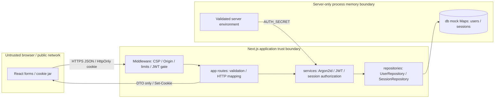

# Nearby stations proxy trust boundary

## Corridor and geocoding server boundary

Public geocode and corridor endpoints delegate strict validated inputs to
services and typed repositories. The shared upstream fetcher permits only HTTPS
on exact Nominatim, OSRM, and OCM hostnames, rejects credentials, nondefault ports
and redirects, bounds streamed JSON to two MiB, and applies abort timeouts.
Nominatim receives a custom identifying User-Agent and India-only queries; search
text and coordinates are never logged. Upstream DTOs are schema-validated.

Typing requests local city/highway landmarks only; public Nominatim is never used
for autocomplete. Explicit Enter without a highlighted suggestion or Search places
requests validated `mode=search` and awaits Nominatim enrichment. Explicit searches
use a process-global one-request-per-second reservation queue (wait at most 1.5 s);
excess demand returns a retryable 503 instead of silently dropping the search.
Explicit results use a separate 500-entry, 24-hour cache. OSRM routes use a bounded five-minute
cache keyed by four-decimal endpoints. Failed routes are explicitly flagged
great-circle fallbacks with five-kilometre geometry steps and 55 km/h estimates.
Detours are approximate twice-perpendicular distances, not road directions.
Corridor candidates combine seeds within expanded bounds and OCM queries at at
most eight route samples; remote coverage is best-effort, not exhaustive.

The existing API and Origin/CSRF controls cover both endpoints; additional IP
limits are 30 geocode and 10 corridor requests per minute. All caches, throttles,
and limits are process-local. Public provider availability, distributed throttling,
and ingress-controlled DNS/forwarded-IP trust remain deployment concerns. Browser
CSP does not change because upstream access is server-only.

Public `GET /api/stations/nearby` validates strict allowlisted query parameters before delegating to the station service and typed repositories. Existing `/api/*` middleware rate limiting applies without requiring a session. Responses expose only station DTOs; error responses are generic and uncached, successful responses are private for 30 seconds.

The OCM repository is the only external station egress: HTTPS `api.openchargemap.io/v3/poi`, constant host verification, redirects rejected, a three-second abort signal, and a streamed two-MiB response bound. The optional server-only API key is sent only as `X-API-Key`. Zod validates upstream fields, removes control characters and limits text lengths; markup remains plain text and must never be rendered as HTML. Unknown connector types are dropped; unknown tariffs are null. Operational OCM connectors indicate availability only approximately, not live occupancy.

The bounded process-local cache holds merged unfiltered public candidates for five minutes, keyed by rounded 0.05-degree cells and radius. Fetching an extra four kilometres around the cell center covers rounding displacement; every request recomputes exact distances and applies all filters independently. OCM errors are logged without payloads or secrets and fall back to deterministic local stations. Local stations are demonstration data, not live availability. Cache and rate limits are per process, not distributed.

CSP allows only `https://basemaps.cartocdn.com` and `https://tiles.basemaps.cartocdn.com` for map image/network requests, with data/blob images and self/blob workers (blob child fallback). Production script/style policies remain nonce-based. OCM is never contacted directly by browsers.

The map workspace fetches the public same-origin discovery endpoints and validates responses with jitless Zod. Location changes abort previous requests; filters operate on validated client data. Geolocation is optional and denied/unavailable requests fall back to Hyderabad. No location is persisted. Station details, network markers and clusters are React text/components rendered through portals, never HTML popups. External navigation URLs contain only validated numeric coordinates.

`/` redirects to public `/map`. Browsing, station details, local autocomplete,
explicit geocoding and corridor planning require no account. Middleware retains
all API rate limits, nonce CSP and the exact trusted-Origin check for POST,
including public corridor requests. There are no protected page prefixes.
The map server component optionally resolves an active session to personalize the
header and registered-EV range context; invalid, expired or revoked sessions render
the guest experience. Guests see Sign in and neutral EV copy. Authentication and
logout return to `/map`; auth/me still requires an active session.

Public discovery does not authorize charging or payment. `authenticatedApi` in
`src/lib/api-http.ts` remains a tested, fail-closed active-session seam for future
Start charging endpoints; their services must additionally authorize the charging
resource and payment operation. No charging endpoint or UI is implemented here.

MapLibre 6 uses a separately bundled same-origin module worker, configured with `setWorkerUrl` and a static `new URL` asset reference. No custom worker scripts, RTL plugins, eval-based application code, or relaxed production CSP are needed. Map styles, glyphs, sprites and vector tiles come from the two allowlisted CARTO origins. Supercluster runs locally on the filtered dataset. Theme changes reload the map style and restore the radius layers.

Workers obey the CSP on their own script response, not the page's network policy. A narrowly matched header for the hashed `/_next/static/media/maplibre-gl-worker.*.mjs` asset therefore permits same-origin/CARTO connections with `default-src 'none'` and self-only scripts. Other static assets retain the baseline policy, and HTML continues to receive nonce-only script/style directives from middleware.

# GridPass V1 architecture

V1 delivers registration, authentication, revocable sessions, nearby charger
discovery and route corridor planning. Seed availability is demonstration data;
public providers and route fallbacks are best-effort. Owners' names, email, phone,
vehicle and password hashes are private data; signing keys and cookies are secrets.

## Guided charging assistant (PR B; algorithm revision 2)

`POST /api/recommendations/charging` is public discovery, not charging/payment authorization. Strict Zod validation bounds battery, variant IDs, car position and region context. The HttpOnly-cookie account pack overrides the body. Legacy labels resolve to their smallest verified pack with `packConfirmed:false` and a confirmation message (XUV 9e → XEV 9e 59; EV6 → 77.4). Explicit registration packs must match the model and persist with confirmation. Legacy guest model requests remain supported conservatively until the step-2 picker. Unsupported selections fail closed. Exact-Origin CSRF, no-store, 60 API/IP/minute and 10 recommendations/IP/minute remain unchanged.

`domain/ev-catalogue.ts` replaces model-only specs with 16 models and 27 verified packs. Every data field has provenance; usable kWh stays null when unpublished. See [EV-DATA-SOURCES.md](EV-DATA-SOURCES.md). Claimed range is not an energy input. `range.service.ts` implements S1–S3/S5: nominal energy, city/highway interpolation at route average speed (40 km/h otherwise), capped high-speed penalty and 1.1 consumption margin.

Search region and car position are separate. Requests carry bounded `carPosition` and `positionSource` (gps/route/assumed). Transport supplies GPS outside route mode, route origin in route mode, or a labelled assumed map centre. Panning never substitutes a map centre for a real car. Non-route distance is car-to-station haversine ×1.3. Route distances start at the car projection and include approach plus detour; fallback roads use ×1.3. Route distance/duration determines consumption speed.

S4/S6–S10 exclude offline/incompatible/zero-power ports, not busy/unknown ports. Demo DTOs carry `statusSource:"demo"`. OCM operational/unspecified occupancy is unknown, never free, with `statusSource:"unknown occupancy"`. A requires unrounded arrival ≥10%; if absent, B accepts distance ≤0.9R, warns and sorts nearest first. Below 10% battery an A label is impossible. N6 offers no stops. All guarantees are conditional on input estimates, not real-world guarantees.

Wait DTOs carry `estimated:true, unverified:true`: free 0, all-busy 30/compatible-count, unknown assumed 10 minutes for scoring but described as unknown. Offline ports never inflate counts/power. Power comes from the same occupancy class as the wait and is capped by the car. Charge time to 80% uses nominal kWh and 1.1 taper. A sorts drive/detour + wait + charge minus free-port/progress bonus; B sorts raw distance, then wait+charge. Ties prefer capped power, then station ID; top three only. Eligibility/score/distance stay unrounded, displayed arrival rounds down to tenths, charging minutes round nearest.

Route messages distinguish P3 optional stops, P4 charging required, N6-route no reachable stop, and P3b a reachable destination without offered stops. P3b suppresses contradictory roadside advice. P4 uses absolute-10%-arrival range, distinct from B's 0.9R. Seeded tests cover proof points 1–6 across all packs, not top-three monotonicity.

Existing camera intents, pinned submitted contexts, cancellation and Back remain. GPS changes also mark results stale without clearing them. Step 1 adds no pack-picker or confirmation UI; transport and old reserve/position copy are minimally corrected so B cannot inherit false guarantees. No dependencies, paid services, runtime data providers or client persistence are added. Charging remains unimplemented and must require active-session/resource/payment authorization.

## Layers and trust boundaries

`app/` renders UI and handles HTTP -> `services/` implements authentication and
resource authorization -> `repositories/` exposes typed persistence interfaces ->
`db/` holds the mock in-memory store. UI uses the API boundary; the map server
component invokes the current-user service. API handlers validate unknown JSON
with strict shared Zod schemas and map safe errors. Services return typed Results
for expected failures and expose only the UserDto allowlist. Repositories enforce
unique normalized email at insertion, including concurrent registration attempts.

The singleton survives development HMR; **all mock data is lost on restart**.
When not in production, MOCK_USER_PASSWORD enables lazy Argon2id-hashed dummy
owners: aarav@example.com, priya@example.com, rohan@example.com. No password is
committed. Production never seeds. This is not durable production identity storage.
Environment validation runs from Next configuration and fails closed for missing
or short AUTH_SECRET; diagnostics name variables, never values. Logs use structured
redacted JSON; no credentials or sensitive bodies are logged.

## Accepted ADRs (V1)

| ADR | Decision and trade-off                                                                                                                                                                                                                                                                                                                                           |
| --- | ---------------------------------------------------------------------------------------------------------------------------------------------------------------------------------------------------------------------------------------------------------------------------------------------------------------------------------------------------------------- |
| 001 | Mock repository behind typed interfaces rather than an ORM now. V2 replaces repository implementations with a real DB, adding migrations, transactions and durability without changing service contracts.                                                                                                                                                        |
| 002 | Argon2id, 19,456 KiB memory, two iterations, one lane. Unknown-email login verifies a precomputed dummy hash with the same cost. Hashing costs CPU; ingress limits remain essential.                                                                                                                                                                             |
| 003 | jose HS256 signed JWT with required issuer, audience, expiry, subject and fresh session ID, plus a server-side seven-day session record. Rotate every authentication; revoke on logout. Cookie is HttpOnly, SameSite=Lax, Path=/, Secure in production. Authenticated actions require the active record and matching owner in services; map discovery is public. |
| 004 | Origin-check CSRF on all mutating API methods: require a canonical HTTP(S) Origin equal to NEXT_PUBLIC_APP_URL. Caller-supplied Host is validated but cannot grant trust, including across schemes. SameSite is defense in depth. Configure the exact HTTPS production origin.                                                                                   |
| 005 | In-memory sliding-window log for authentication: five POST attempts per 15 minutes, separate login/register buckets, bounded keys and 10,000-client map; fail closed at capacity. Existing fixed-window 60/min API limiter is retained. Durable/distributed limiting deferred.                                                                                   |

Middleware replaces caller-supplied nonce headers with a fresh nonce and forwards
the CSP to Next.js for framework scripts. Dynamic rendering prevents nonce reuse
from static HTML caches. Only NODE_ENV=development adds unsafe-eval to script-src
for Next.js React Refresh; test and production retain the strict nonce policy
without unsafe-eval. This local-development exception is not a production control.
Next's development runtime also injects unnonced inline style elements. Only in
development, style-src is therefore self plus unsafe-inline, without a style
nonce (which would cause browsers to ignore unsafe-inline). Script nonces remain
enabled. Test and production keep nonce-only inline-style authorization and never
allow unsafe-inline. Isolated headless Chromium checks confirmed that production
does not have the development runtime's inline-style violations.
Shared Zod initialization sets jitless=true before creating schemas, avoiding its
eval capability probe and generated validators even when the probe would catch
the CSP exception. Production keeps both script and style nonce policies strict.
All middleware responses, including redirects/403/429,
use nonce CSP and no-store. Global headers provide restrictive fallbacks including
excluded assets and errors; HSTS is production-only. Theme preference applies
after mount without an inline script. No raw HTML rendering is used.

Both limiters are per-instance: restarts reset counters and replicas do not share
them. Auth-screen redirects run in server pages and require an active session via
the current-user service. Middleware does not gate the public map by JWT signature.
A still-signed cookie without a session record renders the guest map and does not
redirect away from auth pages after process-memory loss.
Production needs ingress/edge limiting. Forwarded IP headers are ignored unless
TRUST_PROXY_HEADERS=true is explicitly configured. Enable it only behind an
ingress that strips and replaces caller-supplied x-forwarded-for and x-real-ip;
otherwise clients can spoof limiter identity. Without trusted IP headers, callers
share a conservative unknown bucket (a deliberate availability trade-off).

Login, registration and corridor JSON bodies share a streamed 4 KiB limit before
Zod parsing; declared and actual sizes are both enforced. Upstream responses use
the same bounded reader with a separate 2 MiB limit. Neither parser logs content.

## Threat model

Scope: V1 browser, Next runtime and process memory; engineering owns residual risks.
Reassess on persistence, authorization or external integration changes. HTTPS,
trusted ingress and a confidential strong AUTH_SECRET are deployment assumptions.

| Threat                            | Implemented mitigation                                                                                                                                                             | Verification / residual risk                                                                                                                                    |
| --------------------------------- | ---------------------------------------------------------------------------------------------------------------------------------------------------------------------------------- | --------------------------------------------------------------------------------------------------------------------------------------------------------------- |
| Credential stuffing / brute force | Argon2id; 5/15-minute per-IP per-auth-route sliding limit; global API limit                                                                                                        | tests/auth-routes.test.ts, tests/auth-security.test.ts; distributed attacks require ingress defenses                                                            |
| Account enumeration               | Identical 401 body for unknown email and wrong password; dummy hash verification                                                                                                   | tests/auth-routes.test.ts; registration deliberately returns EMAIL_TAKEN/409 per product contract, so signup enumeration remains possible                       |
| XSS                               | React text escaping, strict nonce CSP without unsafe-inline/eval, no raw HTML, HttpOnly cookie                                                                                     | tests/middleware.test.ts, tests/auth-ui.test.tsx; dependency compromise remains a supply-chain risk                                                             |
| CSRF                              | Required trusted Origin on POST/PUT/PATCH/DELETE /api/*; SameSite=Lax                                                                                                              | tests/auth-security.test.ts; relies on ingress Host validation                                                                                                  |
| Session hijacking                 | Signed scoped expiring JWT plus active server record, fresh ID on login/register, logout revocation, secure production cookie, no-store, relative next validation                  | tests/auth-routes.test.ts, tests/auth-security.test.ts, tests/auth-unit.test.ts; stolen sessions work until revocation/expiry                                   |
| SSRF                              | No proxy or external fetch exists in V1. Upcoming map/routing proxies must use fixed upstream host allowlists, no user-supplied URLs, HTTPS only, private-IP blocking and timeouts | Not implemented/testable in V1; future proxy tests required before release                                                                                      |
| API abuse                         | Existing 60/min API limit plus bounded authentication sliding-window limiter; strict schemas reject unknown fields                                                                 | tests/rate-limit.test.ts, tests/middleware.test.ts, tests/auth-security.test.ts, tests/auth-routes.test.ts; per-instance state is not a distributed DoS defense |

Lockfile installs, pinned CI actions, dependency audit, Gitleaks and Semgrep guard
the contributor-to-CI boundary. The public health route exposes constant status
only. V2 must add durable data lifecycle/retention, session cleanup and shared
limiting before treating this mock implementation as production-ready storage.
