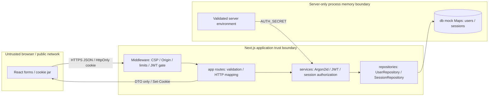

# Nearby stations proxy trust boundary

## Corridor and geocoding server boundary

Authenticated geocode and corridor endpoints delegate strict validated inputs to
services and typed repositories. The shared upstream fetcher permits only HTTPS
on exact Nominatim, OSRM, and OCM hostnames, rejects credentials, nondefault ports
and redirects, bounds streamed JSON to two MiB, and applies abort timeouts.
Nominatim receives a custom identifying User-Agent and India-only queries; search
text and coordinates are never logged. Upstream DTOs are schema-validated.

Local city/highway autocomplete matches return immediately, with best-effort
background Nominatim enrichment merged into the cache for subsequent searches.
Searches use a process-global one-request-per-second Nominatim
throttle and a 500-entry, 24-hour cache. OSRM routes use a bounded five-minute
cache keyed by four-decimal endpoints. Failed routes are explicitly flagged
great-circle fallbacks with five-kilometre geometry steps and 55 km/h estimates.
Detours are approximate twice-perpendicular distances, not road directions.
Corridor candidates combine seeds within expanded bounds and OCM queries at at
most eight route samples; remote coverage is best-effort, not exhaustive.

The existing API and Origin/CSRF controls cover both endpoints; additional IP
limits are 30 geocode and 10 corridor requests per minute. All caches, throttles,
and limits are process-local. Public provider availability, distributed throttling,
and ingress-controlled DNS/forwarded-IP trust remain deployment concerns. Browser
CSP does not change because upstream access is server-only.

Authenticated `GET /api/stations/nearby` validates strict allowlisted query parameters before delegating to the station service and typed repositories. Existing `/api/*` middleware rate limiting applies. Session cookies are read from request headers, never reconstructed as requests. Responses expose only station DTOs; error responses are generic and uncached, successful responses are private for 30 seconds.

The OCM repository is the only external station egress: HTTPS `api.openchargemap.io/v3/poi`, constant host verification, redirects rejected, a three-second abort signal, and a streamed two-MiB response bound. The optional server-only API key is sent only as `X-API-Key`. Zod validates upstream fields, removes control characters and limits text lengths; markup remains plain text and must never be rendered as HTML. Unknown connector types are dropped; unknown tariffs are null. Operational OCM connectors indicate availability only approximately, not live occupancy.

The bounded process-local cache holds merged unfiltered public candidates for five minutes, keyed by rounded 0.05-degree cells and radius. Fetching an extra four kilometres around the cell center covers rounding displacement; every request recomputes exact distances and applies all filters independently. OCM errors are logged without payloads or secrets and fall back to deterministic local stations. Local stations are demonstration data, not live availability. Cache and rate limits are per process, not distributed.

CSP allows only `https://basemaps.cartocdn.com` and `https://tiles.basemaps.cartocdn.com` for map image/network requests, with data/blob images and self/blob workers (blob child fallback). Production script/style policies remain nonce-based. OCM is never contacted directly by browsers.

The map workspace fetches only the authenticated same-origin stations endpoint and validates the response with jitless Zod. Location changes abort previous requests; filters operate on validated client data. Geolocation is optional and denied/unavailable requests fall back to Hyderabad. No location is persisted. Station details, network markers and clusters are React text/components rendered through portals, never HTML popups. External navigation URLs contain only validated numeric coordinates.

MapLibre 6 uses a separately bundled same-origin module worker, configured with `setWorkerUrl` and a static `new URL` asset reference. No custom worker scripts, RTL plugins, eval-based application code, or relaxed production CSP are needed. Map styles, glyphs, sprites and vector tiles come from the two allowlisted CARTO origins. Supercluster runs locally on the filtered dataset. Theme changes reload the map style and restore the radius layers.

Workers obey the CSP on their own script response, not the page's network policy. A narrowly matched header for the hashed `/_next/static/media/maplibre-gl-worker.*.mjs` asset therefore permits same-origin/CARTO connections with `default-src 'none'` and self-only scripts. Other static assets retain the baseline policy, and HTML continues to receive nonce-only script/style directives from middleware.

# GridPass V1 architecture

V1 delivers registration, authentication, revocable sessions and an account-gated
map placeholder. It does not deliver mapping, charging availability or routing.
The network preview is explicitly sample telemetry. Owners' names, email, phone,
vehicle and password hashes are private data; signing keys and cookies are secrets.

## Layers and trust boundaries

`app/` renders UI and handles HTTP -> `services/` implements authentication and
resource authorization -> `repositories/` exposes typed persistence interfaces ->
`db/` holds the mock in-memory store. UI uses the API boundary; the map server
component invokes the current-user service. API handlers validate unknown JSON
with strict shared Zod schemas and map safe errors. Services return typed Results
for expected failures and expose only the UserDto allowlist. Repositories enforce
unique normalized email at insertion, including concurrent registration attempts.

The singleton survives development HMR; **all mock data is lost on restart**.
When not in production, MOCK_USER_PASSWORD enables lazy Argon2id-hashed dummy
owners: aarav@example.com, priya@example.com, rohan@example.com. No password is
committed. Production never seeds. This is not durable production identity storage.
Environment validation runs from Next configuration and fails closed for missing
or short AUTH_SECRET; diagnostics name variables, never values. Logs use structured
redacted JSON; no credentials or sensitive bodies are logged.

## Accepted ADRs (V1)

| ADR | Decision and trade-off                                                                                                                                                                                                                                                                                                                                   |
| --- | -------------------------------------------------------------------------------------------------------------------------------------------------------------------------------------------------------------------------------------------------------------------------------------------------------------------------------------------------------- |
| 001 | Mock repository behind typed interfaces rather than an ORM now. V2 replaces repository implementations with a real DB, adding migrations, transactions and durability without changing service contracts.                                                                                                                                                |
| 002 | Argon2id, 19,456 KiB memory, two iterations, one lane. Unknown-email login verifies a precomputed dummy hash with the same cost. Hashing costs CPU; ingress limits remain essential.                                                                                                                                                                     |
| 003 | jose HS256 signed JWT with required issuer, audience, expiry, subject and fresh session ID, plus a server-side seven-day session record. Rotate every authentication; revoke on logout. Cookie is HttpOnly, SameSite=Lax, Path=/, Secure in production. Middleware verifies signatures only; services also require the active record and matching owner. |
| 004 | Origin-check CSRF on all mutating API methods: require a valid HTTP(S) Origin equal to the configured app origin or matching the request Host. SameSite is defense in depth, not the CSRF control. Trusted ingress must validate Host.                                                                                                                   |
| 005 | In-memory sliding-window log for authentication: five POST attempts per 15 minutes, separate login/register buckets, bounded keys and 10,000-client map; fail closed at capacity. Existing fixed-window 60/min API limiter is retained. Durable/distributed limiting deferred.                                                                           |

Middleware replaces caller-supplied nonce headers with a fresh nonce and forwards
the CSP to Next.js for framework scripts. Dynamic rendering prevents nonce reuse
from static HTML caches. Only NODE_ENV=development adds unsafe-eval to script-src
for Next.js React Refresh; test and production retain the strict nonce policy
without unsafe-eval. This local-development exception is not a production control.
Next's development runtime also injects unnonced inline style elements. Only in
development, style-src is therefore self plus unsafe-inline, without a style
nonce (which would cause browsers to ignore unsafe-inline). Script nonces remain
enabled. Test and production keep nonce-only inline-style authorization and never
allow unsafe-inline. Isolated headless Chromium checks confirmed that production
does not have the development runtime's inline-style violations.
Shared Zod initialization sets jitless=true before creating schemas, avoiding its
eval capability probe and generated validators even when the probe would catch
the CSP exception. Production keeps both script and style nonce policies strict.
All middleware responses, including redirects/403/429,
use nonce CSP and no-store. Global headers provide restrictive fallbacks including
excluded assets and errors; HSTS is production-only. Theme preference applies
after mount without an inline script. No raw HTML rendering is used.

Both limiters are per-instance: restarts reset counters and replicas do not share
them. Auth-screen redirects run in server pages and require an active session via
the current-user service; middleware only gates protected routes by JWT signature.
A still-signed cookie without a session record therefore cannot cause a redirect
loop between the map and login after process-memory loss.
Production needs ingress/edge limiting. Trusted ingress must strip and
replace caller-supplied x-forwarded-for and x-real-ip; otherwise clients can spoof
limiter identity. Clients without these headers share an unknown bucket.

## Threat model

Scope: V1 browser, Next runtime and process memory; engineering owns residual risks.
Reassess on persistence, authorization or external integration changes. HTTPS,
trusted ingress and a confidential strong AUTH_SECRET are deployment assumptions.

| Threat                            | Implemented mitigation                                                                                                                                                             | Verification / residual risk                                                                                                                                    |
| --------------------------------- | ---------------------------------------------------------------------------------------------------------------------------------------------------------------------------------- | --------------------------------------------------------------------------------------------------------------------------------------------------------------- |
| Credential stuffing / brute force | Argon2id; 5/15-minute per-IP per-auth-route sliding limit; global API limit                                                                                                        | tests/auth-routes.test.ts, tests/auth-security.test.ts; distributed attacks require ingress defenses                                                            |
| Account enumeration               | Identical 401 body for unknown email and wrong password; dummy hash verification                                                                                                   | tests/auth-routes.test.ts; registration deliberately returns EMAIL_TAKEN/409 per product contract, so signup enumeration remains possible                       |
| XSS                               | React text escaping, strict nonce CSP without unsafe-inline/eval, no raw HTML, HttpOnly cookie                                                                                     | tests/middleware.test.ts, tests/auth-ui.test.tsx; dependency compromise remains a supply-chain risk                                                             |
| CSRF                              | Required trusted Origin on POST/PUT/PATCH/DELETE /api/*; SameSite=Lax                                                                                                              | tests/auth-security.test.ts; relies on ingress Host validation                                                                                                  |
| Session hijacking                 | Signed scoped expiring JWT plus active server record, fresh ID on login/register, logout revocation, secure production cookie, no-store, relative next validation                  | tests/auth-routes.test.ts, tests/auth-security.test.ts, tests/auth-unit.test.ts; stolen sessions work until revocation/expiry                                   |
| SSRF                              | No proxy or external fetch exists in V1. Upcoming map/routing proxies must use fixed upstream host allowlists, no user-supplied URLs, HTTPS only, private-IP blocking and timeouts | Not implemented/testable in V1; future proxy tests required before release                                                                                      |
| API abuse                         | Existing 60/min API limit plus bounded authentication sliding-window limiter; strict schemas reject unknown fields                                                                 | tests/rate-limit.test.ts, tests/middleware.test.ts, tests/auth-security.test.ts, tests/auth-routes.test.ts; per-instance state is not a distributed DoS defense |

Lockfile installs, pinned CI actions, dependency audit, Gitleaks and Semgrep guard
the contributor-to-CI boundary. The public health route exposes constant status
only. V2 must add durable data lifecycle/retention, session cleanup and shared
limiting before treating this mock implementation as production-ready storage.
